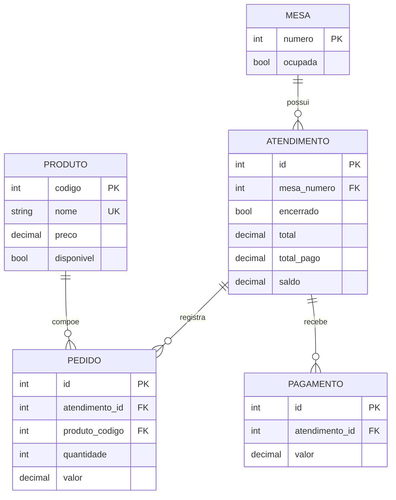

# Sistema de Comandas de Restaurante — Banco de Dados

## Identificação do grupo

- **Integrantes:** Lucas Barbosa de Lima, Larissa beatriz Teixeira de Sousa, Vitória Vale Oliveira
- **Turma:** 2V - INFOWEB
- **Estudo de caso:** sistema de controle de mesas, atendimentos, pedidos, produtos e pagamentos de um restaurante, registro de comandas.
- **Repositório do projeto:** https://github.com/lariescolar/RegistroDeComandas/tree/main

## Descrição

Esta etapa transforma o Diagrama Entidade-Relacionamento (DER) do sistema de restaurante em um banco de dados relacional MySQL. O banco permite registrar as mesas, os atendimentos realizados, os produtos do cardápio, os pedidos associados aos atendimentos e os pagamentos recebidos.

## Diagrama Entidade-Relacionamento

**Observação sobre o mapeamento:** no DER original, `ATENDIMENTO` não possuía uma chave primária explícita, e `PEDIDO` e `PAGAMENTO` também não possuíam identificadores próprios. Para identificar cada registro e implementar as relações com chaves estrangeiras, foram acrescentados os campos `id` como chaves primárias nessas três tabelas. O atributo `mesa` de `ATENDIMENTO` foi representado por `mesa_numero`; as listas de pedidos e pagamentos são representadas pelos relacionamentos das tabelas filhas, não por colunas de lista.

## Banco de dados

- **SGBD:** MySQL 8.0.16 ou superior.
- **Nome do banco:** `restaurante_comandas`.
- **Quantidade de tabelas:** 5 (`mesa`, `atendimento`, `produto`, `pedido` e `pagamento`).
- **Quantidade de registros de teste:** 1.140.

### Principais relacionamentos

- Uma mesa pode possuir vários atendimentos ao longo do tempo; cada atendimento está vinculado a uma mesa.
- Um atendimento pode registrar vários pedidos; cada pedido está associado a um produto.
- Um produto pode aparecer em vários pedidos.
- Um atendimento pode receber vários pagamentos.

### Integridade e regras

- Todas as tabelas possuem chave primária.
- Chaves estrangeiras garantem que mesas, atendimentos e produtos referenciados existam.
- O nome do produto é único.
- Quantidade e valores monetários devem ser positivos; totais e saldos não podem ser negativos.
- `total_pago` não pode superar `total`, e `saldo` deve corresponder à diferença `total - total_pago`.
- `DEFAULT` foi definido para o estado inicial da mesa, disponibilidade do produto, estado do atendimento e valores monetários.
- Exclusões de registros referenciados são restringidas (`ON DELETE RESTRICT`) para preservar o histórico de pedidos e pagamentos. Alterações nas chaves referenciadas propagam-se (`ON UPDATE CASCADE`).
- Foi usado `DECIMAL(10,2)` para dinheiro no lugar de `FLOAT`, para evitar erros de precisão em cálculos monetários.

## Massa de dados

O arquivo `database.sql` insere os dados abaixo, totalizando **1.140 registros**:

| Tabela | Registros |
|---|---:|
| `mesa` | 20 |
| `produto` | 50 |
| `atendimento` | 220 |
| `pedido` | 600 |
| `pagamento` | 250 |
| **Total** | **1.140** |

Os dados incluem atendimentos encerrados e atendimentos em aberto, produtos disponíveis e indisponíveis, pedidos com quantidades e preços variados e atendimentos pagos em uma ou duas transações. Os 208 atendimentos encerrados estão totalmente pagos; os 12 atendimentos em aberto permanecem sem pagamento e associados às 12 mesas ocupadas. As outras 8 mesas estão livres.

O valor de cada pedido representa o valor total daquela linha (`preço do produto × quantidade`). O total do atendimento corresponde à soma dos pedidos associados.

## Scripts e arquivos

- **`database.sql`** — cria o banco, as tabelas, as chaves e restrições, e insere toda a massa de dados de teste.
- **`README.md`** — documentação do estudo de caso, do DER, do modelo relacional e da massa de teste.

## Como executar

1. Abra o MySQL Workbench ou outro cliente compatível com MySQL 8.0.16 ou superior.
2. Execute o arquivo completo `database.sql` em um usuário com permissão para criar bancos de dados.
3. O script seleciona o banco `restaurante_comandas`, cria as cinco tabelas na ordem correta e insere os registros.

O script foi preparado para um banco novo/vazio. Ele usa `CREATE DATABASE IF NOT EXISTS`; se já existirem tabelas com esses nomes nesse banco, remova-as ou utilize um banco limpo antes da execução.
