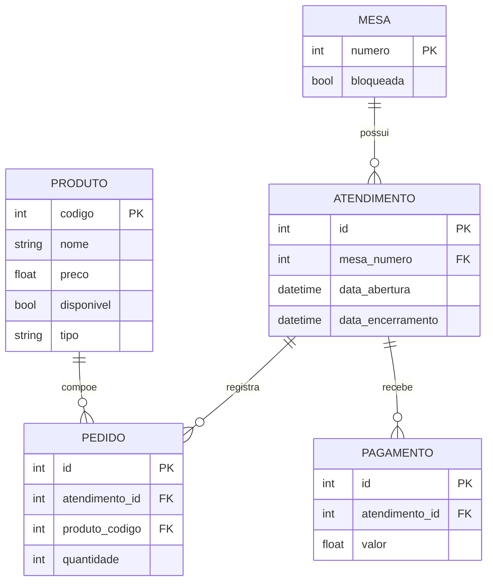

# 🍔 Registro de Comandas — Sabor da Orla

Sistema orientado a objetos desenvolvido para a lanchonete **Sabor da Orla**, com o objetivo de substituir o controle manual de comandas de papel por um sistema informatizado.

---

## 👥 Equipe

- Vitória Vale de Oliveira Da Silva
- Lucas Barbosa de Lima
- Larissa Beatriz Teixeira de Sousa

---

## 📌 Sobre o projeto

O sistema permite controlar as comandas da lanchonete desde a abertura do atendimento até o seu encerramento.

Durante um atendimento, é possível registrar os produtos consumidos, acompanhar o valor total da comanda, realizar pagamentos parciais, consultar o valor já pago e verificar o saldo restante.

Após a quitação da conta, o atendimento pode ser encerrado e a mesa volta a ficar disponível. Os atendimentos encerrados permanecem registrados para consulta do histórico.

Os dados são **persistidos em um banco de dados SQLite** (`dados/lanchonete.db`) por meio do **SQLAlchemy ORM**. Os registros permanecem salvos após o encerramento do programa e cada alteração é confirmada no banco (`commit`) pelos serviços.

O sistema também permite **bloquear e desbloquear mesas**. Uma mesa bloqueada não pode receber novas comandas, e o bloqueio nunca apaga nem altera os registros das comandas já existentes.

---

## ⚙️ Funcionalidades

### 🪑 Mesas
- Cadastrar mesas;
- Exibir automaticamente a situação de todas as mesas ao abrir o Menu de Mesas:
  - `Mesa 1 - Disponível`
  - `Mesa 2 - Ocupada - Total: R$ 35,00 - Pago: R$ 20,00`
  - `Mesa 3 - Indisponível (bloqueada)`
- Listar mesas (mesma listagem, com total e valor pago das mesas ocupadas);
- Consultar disponibilidade (situação de bloqueio e de ocupação);
- Bloquear uma mesa cadastrada;
- Desbloquear uma mesa anteriormente bloqueada;
- Ocupar uma mesa ao abrir um atendimento;
- Liberar a mesa após o encerramento.

### 🍹 Produtos
- Cadastrar produtos;
- Listar produtos;
- Consultar produtos;
- Trabalhar com diferentes tipos de produtos utilizando herança e polimorfismo.

### 🧾 Atendimentos
- Exibir, antes das opções do Menu de Atendimento, o total geral dos atendimentos e o total geral dos pagamentos registrados;
- Abrir atendimento (somente em mesas desbloqueadas e livres, informando o motivo quando a abertura é recusada);
- Consultar uma comanda;
- Registrar pedidos;
- Consultar o consumo;
- Registrar pagamentos;
- Consultar pagamentos;
- Consultar o saldo;
- Encerrar atendimento;
- Consultar o histórico.

### 💳 Pagamentos
- Registrar pagamentos parciais;
- Consultar o total pago;
- Calcular o saldo restante;
- Impedir pagamentos superiores ao saldo da comanda.

---

## 🏗️ Estrutura do projeto

```
RegistroDeComandas/
│
├── .gitignore
├── README.md
│
└── lanchonete_registro_comandas/
    ├── main.py
    ├── aplicacao.py            (sessão do banco + acesso aos serviços)
    ├── formatacao.py
    ├── requirements.txt
    │
    ├── dados/                  (lanchonete.db é gerado automaticamente)
    │
    ├── modelos/                (modelos ORM)
    │   ├── __init__.py
    │   ├── base.py
    │   ├── mesa.py
    │   ├── atendimento.py
    │   ├── produto.py
    │   ├── pedido.py
    │   └── pagamento.py
    │
    ├── excecoes/
    │   ├── __init__.py
    │   └── lanchonete_error.py
    │
    ├── persistencia/
    │   ├── __init__.py
    │   └── banco.py            (engine, criar_tabelas, criar_sessao)
    │
    ├── servicos/
    │   ├── __init__.py
    │   ├── mesa_service.py
    │   ├── produto_service.py
    │   ├── atendimento_service.py
    │   ├── pedido_service.py
    │   └── pagamento_service.py
    │
    └── interface/
        ├── __init__.py
        ├── menu.py
        ├── tela.py
        ├── menus/
        │   ├── __init__.py
        │   ├── menu_principal.py
        │   ├── menu_mesas.py
        │   ├── menu_produtos.py
        │   └── menu_atendimentos.py
        └── telas/
            ├── __init__.py
            ├── tela_mesas.py
            ├── tela_produtos.py
            └── tela_atendimentos.py
```

## 🧩 Modelos
O sistema possui os seguintes modelos principais:
- Mesa
- Atendimento
- Produto
- Pedido
- Pagamento

Todos os modelos herdam de `Base` (SQLAlchemy `DeclarativeBase`) e são mapeados para tabelas do banco.

| Modelo | Tabela | Identificador |
| --- | --- | --- |
| `Mesa` | `mesas` | `numero` (informado pelo usuário) |
| `Produto` / `Suco` / `Sanduiche` | `produtos` | `codigo` (informado pelo usuário) |
| `Atendimento` | `atendimentos` | `id` (automático) |
| `Pedido` | `pedidos` | `id` (automático) |
| `Pagamento` | `pagamentos` | `id` (automático) |

A classe Produto é a base de uma hierarquia com **herança de tabela única**: `Suco` e `Sanduiche` são gravados na mesma tabela `produtos`, diferenciados pela coluna `tipo`, o que preserva a herança e o polimorfismo (`descricao()`). Os objetos se relacionam por meio de `relationship()` e chaves estrangeiras.

Os atendimentos registram `data_abertura` (preenchida pelo banco) e `data_encerramento` (`NULL` enquanto o atendimento está em aberto). A situação de ocupação da mesa (`Mesa.ocupada`) é calculada a partir dos atendimentos em aberto, e não armazenada.

## 🔗 Relacionamentos

Os principais relacionamentos entre os objetos são:
```
Mesa 1 ───────── N Atendimento

Atendimento 1 ───────── N Pedido

Produto 1 ───────── N Pedido

Atendimento 1 ───────── N Pagamento
```

Uma mesa pode possuir vários atendimentos ao longo do tempo, porém apenas um atendimento pode estar aberto simultaneamente.

Um atendimento pode possuir vários pedidos e vários pagamentos.

Cada pedido está associado a um produto.

## 💰 Controle da comanda
O Atendimento calcula automaticamente as informações financeiras da comanda.
```
Total
= soma dos valores dos pedidos

Total pago
= soma dos valores dos pagamentos

Saldo
= Total - Total pago
```
Esses valores são calculados a partir dos objetos existentes e não são armazenados manualmente.

## ⚠️ Regras de negócio
Mesas
- Não é permitido abrir dois atendimentos simultaneamente para a mesma mesa.
- Uma mesa ocupada não pode receber um novo atendimento.
- Somente mesas cadastradas podem ser bloqueadas ou desbloqueadas.
- Uma mesa já bloqueada não pode ser bloqueada novamente (mensagem de erro adequada).
- Uma mesa já desbloqueada não pode ser desbloqueada novamente (mensagem de erro adequada).
- Não é permitido abrir uma nova comanda em uma mesa bloqueada; a recusa informa o motivo.
- A abertura de comandas só é permitida em mesas desbloqueadas e livres.
- O bloqueio de uma mesa não apaga nem altera as comandas já existentes (pedidos, pagamentos e histórico permanecem intactos).
- A situação da mesa (bloqueada ou desbloqueada) é exibida nas listagens e consultas.
- Mesa bloqueada e sem atendimento é exibida como `Indisponível (bloqueada)`.
- Mesas ocupadas exibem o total e o valor já pago do atendimento atual, calculados a partir dos dados registrados.
- Os totais gerais consideram todos os atendimentos registrados (abertos e encerrados).

Atendimentos
- Não é permitido registrar pedidos em um atendimento encerrado.
- Não é permitido registrar pagamentos em um atendimento encerrado.
- Não é permitido encerrar um atendimento com saldo pendente.
- Após o encerramento, a mesa volta a ficar disponível.
- O atendimento encerrado permanece no histórico.

Pedidos
- A quantidade deve ser maior que zero.
- O pedido deve estar associado a um produto existente.

Pagamentos
- O valor do pagamento deve ser maior que zero.
- Não é permitido realizar pagamento superior ao saldo da comanda.
- É possível realizar vários pagamentos parciais.

## ⚠️ Exceções personalizadas

O projeto possui uma hierarquia de exceções baseada em LanchoneteError.
```
LanchoneteError
│
├── DadoInvalidoError
├── MesaOcupadaError
├── MesaJaCadastradaError
├── MesaBloqueadaError
├── MesaJaBloqueadaError
├── MesaJaDesbloqueadaError
├── AtendimentoEncerradoError
├── AtendimentoNaoEncontradoError
├── AtendimentoNaoQuitadoError
├── ProdutoNaoEncontradoError
├── ProdutoJaCadastradoError
├── ProdutoIndisponivelError
├── QuantidadeInvalidaError
├── PagamentoInvalidoError
└── PersistenciaError
```

As exceções são utilizadas para impedir operações que violem as regras de negócio do sistema.

## 🖥️ Interface

A interface textual foi organizada em menus e telas, seguindo a separação entre navegação e interação com as funcionalidades.

Menus:
```
MenuPrincipal
│
├── MenuMesas
├── MenuProdutos
└── MenuAtendimentos
```
Telas:
```
TelaMesas
TelaProdutos
TelaAtendimentos
```

## 📊 Diagrama Entidade-Relacionamento



## 📚 Conceitos utilizados

O projeto demonstra a aplicação dos seguintes conceitos de Programação Orientada a Objetos:

- Classes e objetos;
- Encapsulamento;
- Abstração;
- Herança;
- Polimorfismo;
- Relacionamento entre objetos;
- Exceções personalizadas;
- Type Hints;
- Docstrings;
- Organização em módulos e pacotes;
- Persistência em banco de dados com ORM (SQLAlchemy);
- Sessões, transações (`commit` / `rollback`) e context manager (`with`).

## 🚀 Execução

Na pasta `lanchonete_registro_comandas`, crie e ative um ambiente virtual e instale as dependências:

```
python -m venv venv

# Windows
.\venv\Scripts\activate
# Mac/Linux
source venv/bin/activate

pip install -r requirements.txt
```

Para executar o sistema, utilize:

```
python main.py
```

As tabelas são criadas automaticamente na primeira execução. Se a estrutura dos modelos for alterada durante o desenvolvimento, apague `dados/lanchonete.db` para recriá-las (os dados serão perdidos), pois `create_all()` não altera tabelas já existentes.

## 🎯 Fluxo principal
```
Cadastrar mesas e produtos
          ↓
Bloquear / desbloquear mesas (se necessário)
          ↓
Abrir atendimento (somente em mesa desbloqueada e livre)
          ↓
Registrar pedidos
          ↓
Consultar consumo
          ↓
Registrar pagamentos parciais
          ↓
Consultar total pago e saldo
          ↓
Registrar pagamentos restantes
          ↓
Encerrar atendimento
          ↓
Liberar mesa
          ↓
Consultar histórico
```

## 📁 Organização das responsabilidades

```
MODELOS
    ↓
Entidades ORM, relacionamentos e regras do domínio

PERSISTÊNCIA
    ↓
Configuração do banco (engine) e criação de sessões

SERVIÇOS
    ↓
Operações da aplicação (consultas, commit/rollback)

APLICAÇÃO
    ↓
Ciclo de vida da sessão e acesso aos serviços

INTERFACE
    ↓
Menus, telas e interação

EXCEÇÕES
    ↓
Regras que impedem operações inválidas
```
